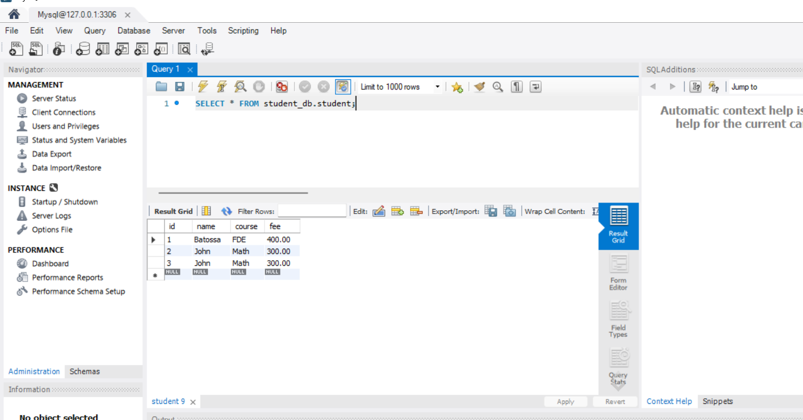

# FastAPI Learning Projects

This repository contains two FastAPI projects:

- **Courses API:** `main.py` and `courses_service.py`
- **Student API:** `student_main.py` and `student_repo.py`, connected to MySQL

## Project Setup Steps

### 1. Create a Python project

Create a project folder and open it in your editor.

### 2. Create a `requirements.txt` file

Add the required libraries to the file, including FastAPI, Uvicorn, and MySQL Connector.

### 3. Create a virtual environment

```bash
python -m venv .venv
```

### 4. Activate the virtual environment

On Windows using PowerShell:

```powershell
.\.venv\Scripts\Activate.ps1
```

### 5. Install the required libraries

```bash
python -m pip install -r requirements.txt
```

### 6. Create the API files

For the courses project:

- `main.py`: FastAPI application and endpoints
- `courses_service.py`: course-related logic

For the student project:

- `student_main.py`: FastAPI application and endpoints
- `student_repo.py`: MySQL connection and student database operations

### 7. Set up the student database

Install MySQL Server and MySQL Workbench. Connect to your local server in Workbench and run:

```sql
CREATE DATABASE student_db;

CREATE TABLE student_db.student (
    id INT AUTO_INCREMENT PRIMARY KEY,
    name VARCHAR(255),
    course VARCHAR(255),
    fee DECIMAL(10, 2)
);
```

### 8. Set the MySQL password

In your PowerShell terminal, run:

```powershell
$env:MYSQL_PASSWORD = Read-Host "Enter your MySQL password" -MaskInput
```

Enter your MySQL root password when prompted. The variable is available for the current terminal session.

### 9. Run an application with Uvicorn

To run the **courses API**:

```bash
python -m uvicorn main:app --reload
```

To run the **student API** from the terminal where you set the password:

```bash
python -m uvicorn student_main:app --reload
```

Run one at a time when using the default port `8000`.

### 10. Test the API

Open Swagger UI:

[http://127.0.0.1:8000/docs](http://127.0.0.1:8000/docs)

You can also test the endpoints with Postman.

### 11. View students in MySQL

In MySQL Workbench, run:

```sql
SELECT * FROM student_db.student;
```

